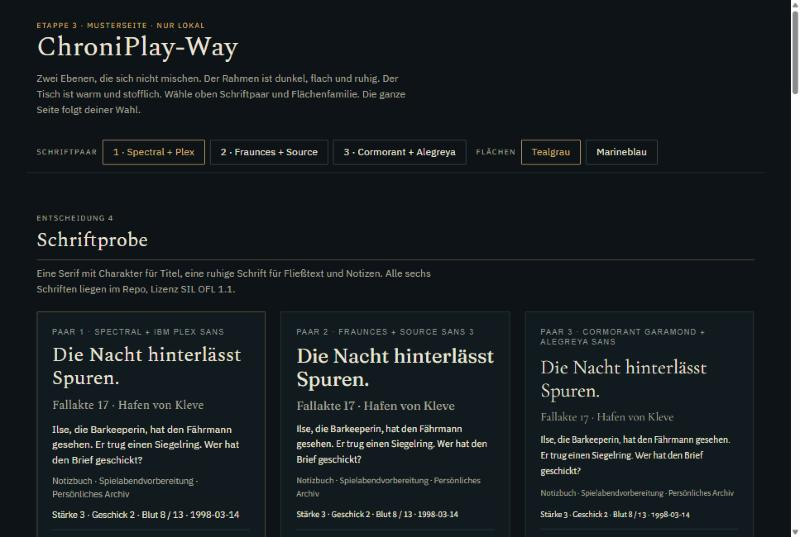
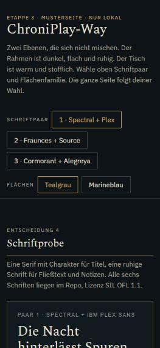
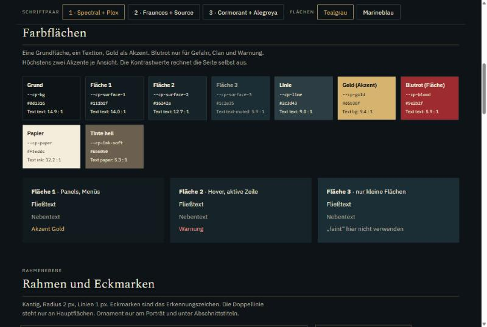
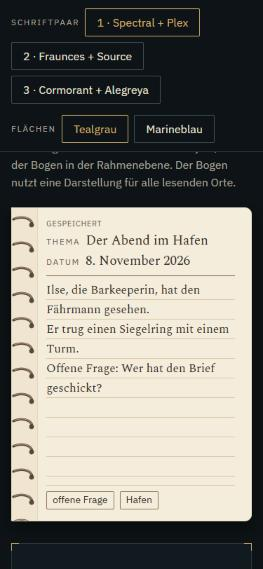
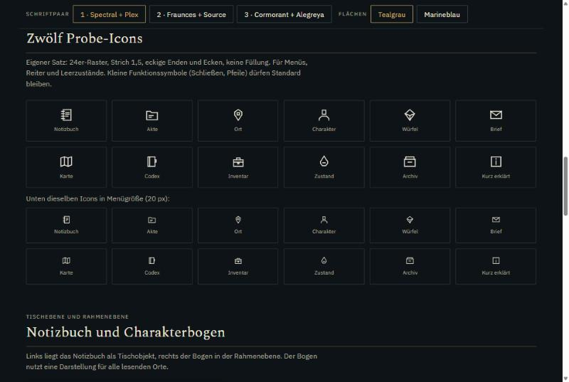
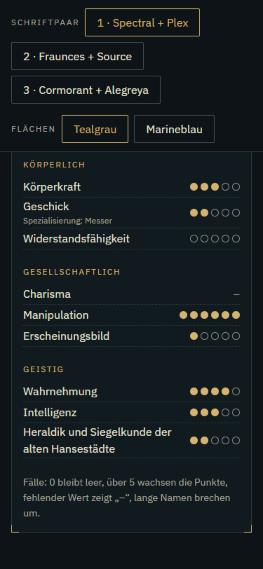
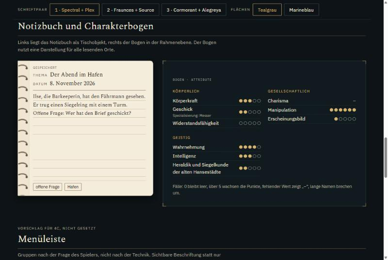
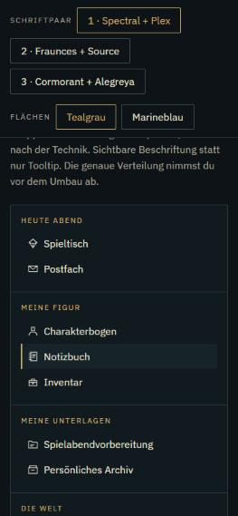
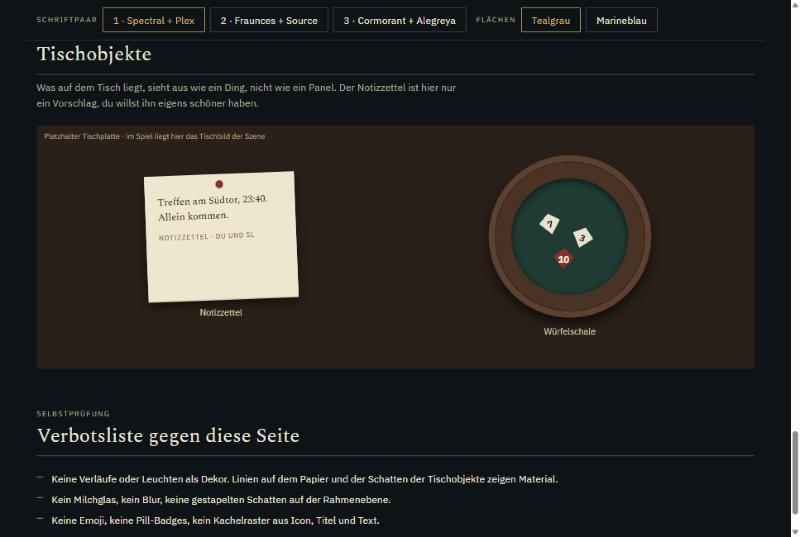
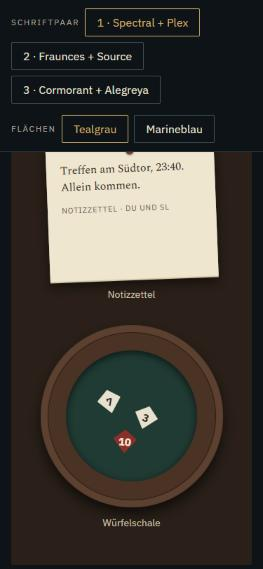

# Etappe 3 · Designgrundlage „ChroniPlay-Way“ · Übergabe

Stand 08.11.2026 · Claude Code (Opus 5.5) · lokal, nicht gepusht, nicht deployt

| | |
|---|---|
| Branch | `claude/designgrundlage` |
| Basis | `claude/notizbuch` @ `da8598d` (Etappe 2, vom Besitzer am 08.11. abgenommen) |
| Stopp | Der Besitzer nimmt die Musterseite ab, verwirft sie oder fordert Änderungen. Erst danach folgt Etappe 4. |

## Lieferung

1. **[docs/design/CHRONIPLAY-WAY.md](../design/CHRONIPLAY-WAY.md)**: Leitidee (Tischebene und Rahmenebene, Sprache der Akte), acht prüfbare Bildregeln, gemessene Kontraste, Verbotsliste, Sprach-DNA, Token-Tabelle.
2. **[docs/design/GLOSSAR.md](../design/GLOSSAR.md)**: ein Wort pro Ding. Die Entscheidungen des Besitzers sind markiert (Notizbuch, Notizzettel, Spielabendvorbereitung, Persönliches Archiv, Eingesteckt, Kurz erklärt).
   - **Vorschlag:** Der Bereich `archiv` (SL-Handouts) heißt künftig „Überlieferungen“, damit „Archiv“ nur noch im „Persönlichen Archiv“ vorkommt.
   - **Vorschlag:** „Chronik erkunden“ wird „Die Welt“.
3. **Tokens `--cp-*`** in `app/globals.css` zwischen `/* cp-tokens:start */` und `/* cp-tokens:end */`, insgesamt 69 Variablen:
   - Grund, zwei Flächenfamilien (Tealgrau und Marineblau), Text, Gold, Blutrot, Papier und Tinte;
   - zwei Schrift-Tokens, Größen, Abstände, Radius, Eckmarke, Icon-Strich, Bewegung.

   Sie sind nur hinzugefügt: Keine bestehende Regel liest sie, ein Test belegt das. Die Schrift-Tokens stehen bis zur Wahl auf Georgia/Arial wie heute.
4. **Musterseite** `prototypes/designgrundlage/musterseite.html`. Sie liegt außerhalb von `app/`, ist nicht im Produktions-Build (nach `pnpm run build` geprüft) und lädt nichts von außen. Inhalt:
   - Umschalter für Schriftpaar und Flächenfamilie (die ganze Seite folgt);
   - Schriftprobe mit drei Paaren und jeweils einer Begründung;
   - Farbflächen mit live gerechnetem Kontrast;
   - Rahmen mit Eckmarken und Doppellinie, Porträtrahmen;
   - **zwölf Probe-Icons** (eigener Satz, Strich 1,5, eckig) in 32 und 20 px;
   - Notizbuchseite (Tischebene);
   - Charakterbogen-Ausschnitt (Rahmenebene) mit den Pflichtfällen: Wert 0, Wert über 5, fehlender Wert „–“, Spezialisierung, sehr langer Name;
   - Menüleiste (Vorschlag „Heute Abend / Meine Figur / Meine Unterlagen / Die Welt“, nicht gesetzt);
   - Leerzustand;
   - Tischobjekte Notizzettel und Würfelschale auf einer als Platzhalter beschrifteten Tischfläche;
   - Selbstprüfung gegen die Verbotsliste.
5. **Schriften** (mit Freigabe des Besitzers geladen): sechs Familien je 400 und 700, latin, woff2, zusammen 312 KB. Jede Lizenz ist die SIL OFL 1.1, liegt bei und ist in [fonts/HERKUNFT.md](../../prototypes/designgrundlage/fonts/HERKUNFT.md) mit Quelle und Version nachgewiesen. Keine npm-Abhängigkeit, die Lockfiles sind unverändert.
6. **Test** `tests/design-tokens.test.mjs` (in `pnpm test`):
   - Musterseite und `globals.css` haben dieselben Tokens;
   - keine App-Regel liest `--cp-*`;
   - alle Textfarben erreichen auf allen Flächen beider Familien und auf Papier mindestens 4,5:1;
   - die Musterseite wird von keinem Code verlinkt, und jede Schrift trägt ihre Lizenz.

## Musterseite ansehen

```
python -m http.server 8898 --bind 127.0.0.1 --directory prototypes/designgrundlage
```

Dann `http://127.0.0.1:8898/musterseite.html` öffnen. Als Datei per Doppelklick fehlen je nach Browser die Schriften, weil Browser lokale Schriftdateien oft sperren.

## Bildschirmfotos (Paar 1, Tealgrau)

| 1280 px | 375 px |
|---|---|
|  |  |
|  |  |
|  |  |
|  |  |
|  |  |

## Entscheidungen, die du an der Seite triffst

| Nr. | Entscheidung | Wie |
|---|---|---|
| 3 | Leitidee „Tischebene und Rahmenebene“ mit Akten-Vokabular | bestätigen oder verwerfen |
| 4 | Schriftpaar | 1 Spectral + IBM Plex Sans · 2 Fraunces + Source Sans 3 · 3 Cormorant Garamond + Alegreya Sans |
| 4 | Icon-Stil | die zwölf Proben: eckig, Strich 1,5, ohne Füllung |
| 5 | Flächenfamilie | Tealgrau oder Marineblau |
| – | Glossar-Vorschläge | „Überlieferungen“ für den SL-Bereich `archiv`, „Die Welt“ statt „Chronik erkunden“ |
| – | Tischobjekte | Notizzettel (Vorschlag, wird eigens schöner) und Würfelschale. Deren Materialtöne werden nach Abnahme Tokens |

**Mein Vorschlag:** Paar 1 und Tealgrau. Spectral passt zur Akte, ohne nach Fantasy-Standard auszusehen. Plex hat klare Ziffern für Bogenwerte. Tealgrau ist heute schon die Grundstimmung von Spielerzentrale und Tisch. Die Wahl liegt bei dir.

## Prüfungen (beobachtet)

| Prüfung | Ergebnis |
|---|---|
| `pnpm run typecheck` | ohne Fehler |
| `pnpm test` | **395/395** (+4 Token-Tests) |
| `node --experimental-strip-types --test tests/*.test.mjs` | **509/515**, dieselben 6 Altfälle wie auf dem Basisstand |
| ESLint `tests/design-tokens.test.mjs` | ohne Befund |
| `pnpm run build` | erfolgreich, `dist/` enthält keine Spur von Musterseite oder Schriftproben |
| Browser 1280 und 375 px (eingebaute Vorschau, über lokalen Server) | alle Abschnitte geladen, Schriften aktiv, Umschalter funktionieren (auch vom Besitzer selbst bedient). Bei 375 px kein waagerechter Scroll (`scrollWidth` 375) |

Beim Durchsehen behoben:
- Fließtext außerhalb der Schriftkarten hing an der falschen Ebene und blieb in Arial;
- im Bogenausschnitt brachen Namen mitten im Wort.

## Prüfgrenzen

- Kein echtes Mobilgerät, kein Screenreader-Durchgang auf der Musterseite.
- Die Farbwerte der Flächen habe ich gegen die Tokens gerechnet, nicht gegen gerenderte Screenshots der heutigen App.
- **Tischplatte:** Das echte Tischbild ist ein hochgeladenes Szenenbild und liegt nicht im Repo. Die Tischobjekte stehen deshalb auf einer schlichten Platzhalterfläche.
- **Umschalter bei 375 px:** Die Leiste bleibt beim Scrollen oben stehen und nimmt dort viel Höhe ein. Sie ist ein Probenwerkzeug, kein Vorschlag für die App.
- **Rahmen und Fokus:** Eckmarken, Doppellinie und Fokusring sind nur hier geprüft, noch nicht in der App.

## Ausdrücklich nicht getan

Kein Umbau der App: Die Tokens wirken nirgends, keine Komponente ist geändert. Kein Push, kein Deployment, keine neue Abhängigkeit, keine KI-generierten Bilder. Die Notizbuch-Tokens `--nb-*` aus Etappe 2 sind noch nicht auf `--cp-*` umgestellt, das folgt in Etappe 4. `.claude/launch.json` (Startbefehl für die Vorschau) ist ein lokales Werkzeug und nicht committet.
