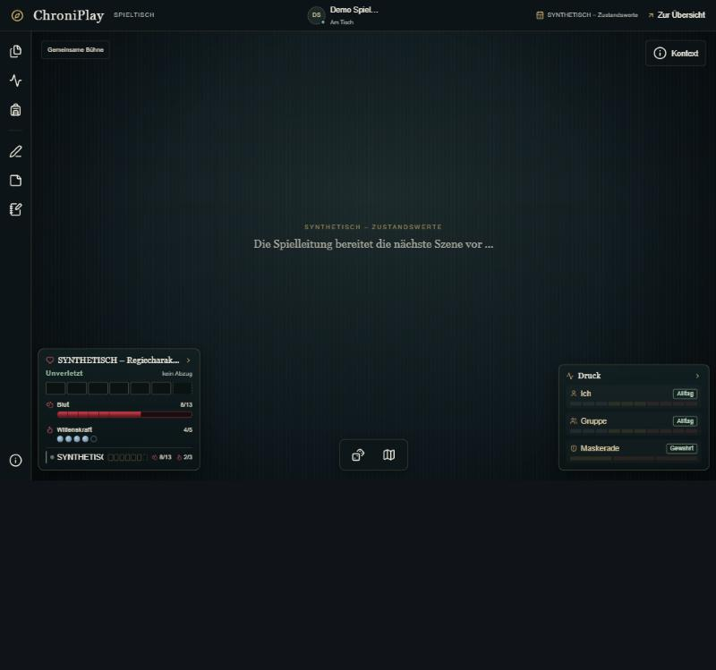
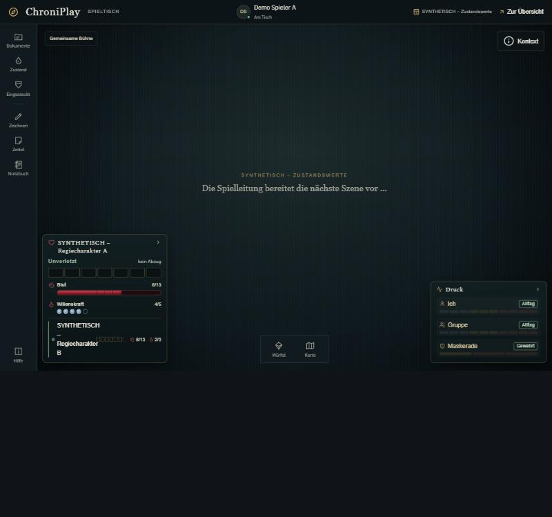
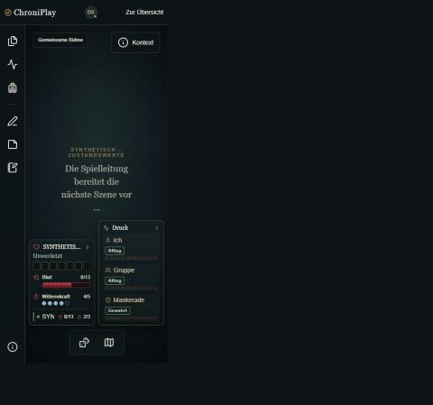
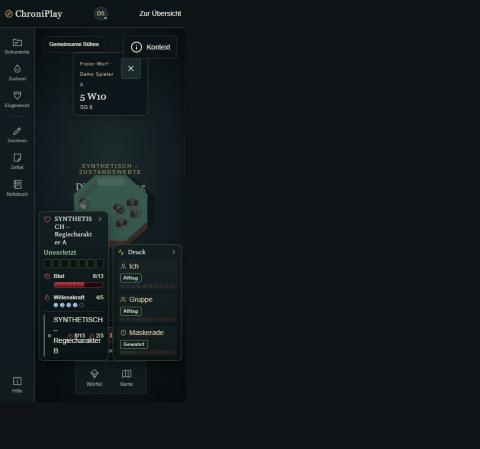
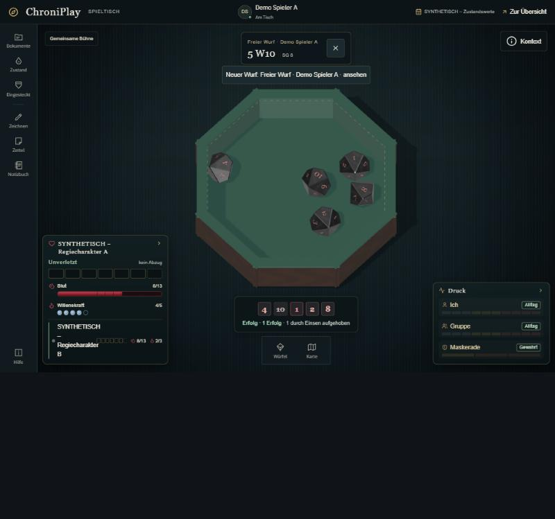
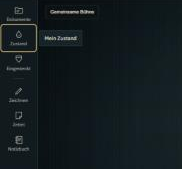
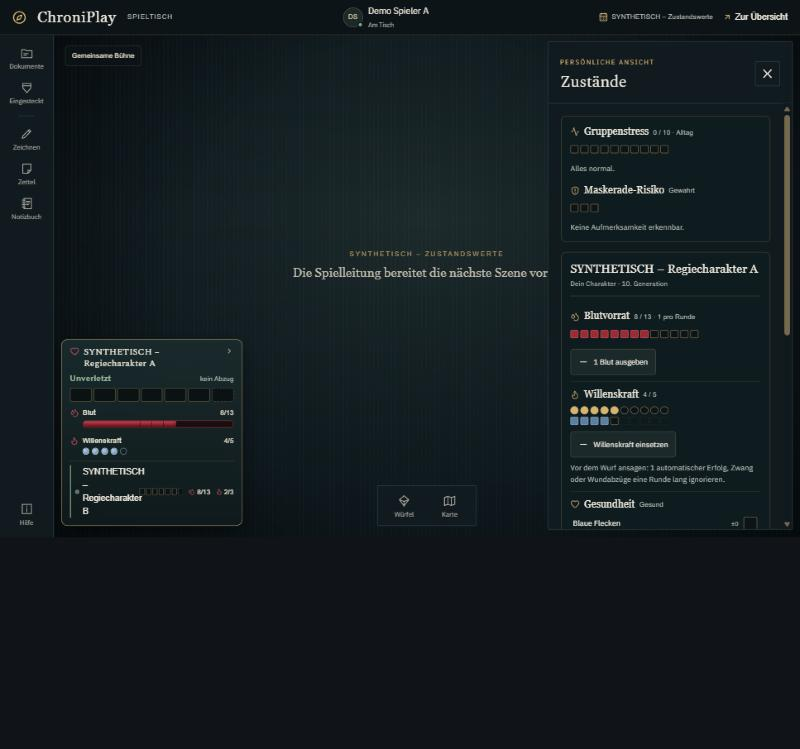

# Etappe 4.0 und 4a · Grundlage anwenden, Leisten am Spieltisch · Übergabe

Stand 08.11.2026 · Claude Code (Opus 5.5) · lokal, nicht gepusht, nicht deployt

| | |
|---|---|
| Branch | `claude/anwenden-designgrundlage` |
| Basis | `claude/designgrundlage` @ `b551bdc` (Etappe 3 mit der Wahl des Besitzers: Spectral + IBM Plex Sans, Tealgrau) |
| Commits | `4c550e9` 4.0 Schrift und Tokens · 4a Leisten (dieser Commit). Beide lassen sich einzeln zurücknehmen. |

## 4.0 · Grundlage in die App

- Spectral und IBM Plex Sans werden **selbst gehostet** aus `public/fonts/` ausgeliefert (je 400 und 700, latin, woff2). Lizenz SIL OFL 1.1 und Herkunft stehen in `public/fonts/HERKUNFT.md`. `@font-face` steht in `app/globals.css`.
- Die Tokens sind festgelegt: `--cp-font-title` ist Spectral, `--cp-font-text` ist IBM Plex Sans. Die Marineblau-Familie und die vier nicht gewählten Probeschriften sind entfernt.
- Das Notizbuch nutzt jetzt die `--cp-*`-Tokens und die beiden Schriften und hat keine eigenen Hex-Farben mehr.
- Die Musterseite zeigt nur noch die Wahl und lädt dieselben Schriftdateien. Start: `python -m http.server 8898 --directory .`, dann `/prototypes/designgrundlage/musterseite.html`.
- Der Test `tests/design-tokens.test.mjs` prüft:
  - Musterseite und `globals.css` haben gleiche Tokens;
  - jedes von der App gelesene `--cp-*` ist definiert;
  - die Schriften sind selbst gehostet und tragen ihre Lizenz;
  - es gibt kein CDN und keine Marineblau-Reste;
  - die Kontraste erreichen mindestens 4,5:1.

## 4a · Spielerleiste oben und linke Tischleiste

**Zieltabelle:** [docs/design/4a-ZIELTABELLE.md](../design/4a-ZIELTABELLE.md). Ich habe nur **eine** echte Doppelung gefunden: Das Leistensymbol „Zustand“ und die Rundenanzeige öffnen dasselbe Panel. Auf deine Entscheidung („Ja, streichen“) ist das Leistensymbol „Zustand“ entfernt. Der Einstieg läuft nur noch über die Rundenanzeige unten links; im Browser geprüft, sie öffnet die Schublade „Zustände“. Alle anderen Ziele sind verschiedene Dinge und bleiben, wo sie sind.

**Umgesetzt, ohne Erreichbarkeit, Panel-Typen, Routen oder Rechte zu ändern:**
1. **Eigener Icon-Satz** `app/spielbereich/modules/icons/cp-icons.tsx`: 17 Symbole aus dem abgenommenen Stil (die 12 Proben plus Szenen, Regie, Zeichnen, Zettel, Eingesteckt).
   - Leiste und Dock zeigen eine **sichtbare Kurzbeschriftung**: Szenen, Regie, Dokumente, Zustand, Eingesteckt, Zeichnen, Zettel, Notizbuch, Hilfe, Würfel, Karte. Der volle Name bleibt Tooltip und Screenreader-Text.
   - „Eingesteckt“ hat jetzt ein eigenes Symbol (Tasche) statt des Rucksacks. Der volle Name lautet „Eingesteckt · von der SL ausgespielte Gegenstände“.
2. **Breitere Leiste:** 86 px, auf dem Handy 70 px, eine gemeinsame Variable `--rail-w` für Bühne, HUD und die Schublade der Spielerleiste.
3. **Namen ohne Abschneiden:**
   - Rundenanzeige, eigener Zustand und Spielerleiste brechen um statt „…“. Der ganze Name steht zusätzlich als `title`, die `aria-label` waren schon vollständig.
   - Die Spielerleiste zeigt bis zu zwei Zeilen. Auf dem Handy bleiben die Namen wie bisher ausgeblendet, dort zeigt die Leiste nur Avatare.
4. **Fokus:** Leiste, Dock, Kontext-Knopf und Schubladen-Schließen haben einen sichtbaren Fokusring (`--cp-focus`), per Tastatur geprüft.
5. **Rahmenebene:**
   - Leiste, Dock und Schubladen nutzen `--cp-surface-1`, `--cp-line`, Radius 2 px und keinen Schlagschatten.
   - Titel in Spectral, Bedienung in Plex, die Orientierungszeile der Schublade in Gold-Versalien.
6. **Tischebene:**
   - Die Würfelschale hat Holzrand und dunkelgrünen Filz statt dunklem Leder und Teal. Das gilt im 3D-Modell (`dice-tray.mjs`, nur Material und Textur) und im Ersatzbild ohne WebGL.
   - Die achteckige Form bleibt, weil die Würfelphysik an genau diesen acht Wänden hängt.
   - Notizzettel sind unverändert, auf deinen Wunsch: Sie werden eigens schöner gestaltet.

## Bildschirmfotos (lokale Instanz `--ge-01`, Spieler A)

| | vorher | nachher |
|---|---|---|
| 1280 px |  |  |
| 375 px |  |  |
| Würfelschale 1280 px | (vorher Leder und Teal, siehe Screenshots des Besitzers) |  |
| Fokus per Tastatur | |  |
| Zustand über die Rundenanzeige | |  |

## Prüfungen (beobachtet)

| Prüfung | Ergebnis |
|---|---|
| Routenliste (`page`/`route`/`layout` unter `app/`) vor und nach dem Umbau | gleich, 90 Dateien, kein Befund im diff |
| `pnpm run typecheck` | ohne Fehler |
| `pnpm test` | **396/396** |
| `node --experimental-strip-types --test tests/*.test.mjs` | **510/516**, dieselben 6 Altfälle wie auf dem Basisstand |
| ESLint auf allen geänderten und neuen Code-Dateien | ohne Befund |
| `pnpm run build` | erfolgreich |
| `pnpm run test:integration:run` | Exit 0 (2.151 + 46 Rollenprüfungen) |
| Browser 1280 und 375 px | Leistenbeschriftungen vollständig, Namen oben vollständig, Fokusring sichtbar, Würfelwurf mit neuer Schale |
| Kontrast | Leistenbeschriftung `--cp-text-muted` auf `--cp-surface-1` 7,4:1, aktiv `--cp-text` 14,0:1 |
| Verbotsliste | kein Dekorverlauf, kein Blur und kein Schlagschatten auf Leiste, Dock und Schubladen, keine Emoji, keine Pill-Badges |
| reduzierte Bewegung | unverändert, die bestehende Regel `prefers-reduced-motion` der Bühne gilt weiter. Keine neue Animation |

Beim Durchsehen behoben:
- Leistenbeschriftungen brachen mitten im Wort;
- Namen wurden in schmalen Spalten zerhackt;
- der Holzrand der Schale war zu hell und streifig.

Die lokale Testdatenbank `.local-test/ge-01` ist danach gelöscht.

## Prüfgrenzen

- **Kein echtes Mobilgerät**, kein Screenreader-Durchgang.
- **Schmale Zustandskarte (375 px):** Das synthetische Wort „SYNTHETISCH“ ist breiter als die Karte und bricht deshalb mitten im Wort. Echte Namen mit Leerzeichen oder Bindestrich brechen an diesen Stellen.
- **SL-Ansicht:** Die Leiste mit Szenen und Regie habe ich nicht im Browser angesehen, nur als Spieler. Der Code ist für beide Rollen derselbe.
- **Würfelschale:** Nur mit WebGL im Browser gesehen. Das Ersatzbild ohne WebGL ist nur per CSS geändert und nicht im Browser ausgelöst.
- **Weitere Tischflächen:** Panels der Bühne außerhalb von Leiste, Dock und Schubladen-Rahmen (z. B. Zustandskarte, Druck-Anzeige, Würfelergebnis) sind noch im alten Stil.

## Offene Punkte

- **„Mein Zustand“:** grafische und technische Überarbeitung als eigener Auftrag. Dazu gehört dein Befund, dass du als SL mit eigener Figur deine Werte nicht siehst.
- **4b Charakterbogen:** braucht die Abweichungsliste gegen dein V20-Referenzblatt. Du hast den Drive-Ordner genannt (leeres Blatt „ohne Werte“); ich lese ihn zu Beginn von 4b, er kommt nicht ins Repo.
- **4c Navigation:** Zieltabelle und Gruppen nimmst du vor dem Umbau ab.

## Ausdrücklich nicht getan

Kein Push, kein Deployment, keine Migration, keine neue npm-Abhängigkeit, keine geänderten Routen, IDs, Rechte oder Panel-Typen. Die Würfelphysik und die Form der Schale sind unverändert, die Notizzettel ebenfalls.
