# Etappe 4b · Charakterbogen · Übergabe

Stand 08.11.2026 · Claude Code (Opus 5.5) · lokal, nicht gepusht, nicht deployt

| | |
|---|---|
| Branch | `claude/anwenden-designgrundlage` |
| Basis | `8eac35a` (4a, vom Besitzer am 08.11. abgenommen) |
| Commit | 4b (dieser Commit), einzeln zurücknehmbar |

## Referenz

- **Blatt:** das zweiseitige deutsche V20-Blatt aus dem Drive-Ordner des Besitzers (`V20_2-Page_Neonate_Interactive_German.pdf`).
- **Ausgefülltes Blatt:** Es enthält den Charakter einer Mitspielerin. Nach Vorgabe des Besitzers („ohne Werte“) habe ich nur Felder, Gruppen, Reihenfolge und Punktanzahl verglichen. Es stehen keine Werte, Namen oder persönlichen Angaben im Repo.
- **Speicherort:** Das Blatt selbst liegt nicht im Repo.

## Abweichungsliste

[docs/design/4b-ABWEICHUNGSLISTE.md](../design/4b-ABWEICHUNGSLISTE.md): Feld für Feld, Seite 1 und 2, für Spielerzentrale bzw. SL-Ansicht und das Ingame-Menü.

## Änderungen (nur Darstellung, Rechte und Daten unverändert)

1. **Ein Bogenmodell** `domain/character-sheet-view.ts` (rein, ohne Oberfläche): baut aus der bestehenden Projektion die Sicht des Papierbogens. Es nutzt die in Etappe 1 geretteten Hilfen `sheetNumber`, `dotSlots` und `dotLabel` (`domain/sheet-values.ts`) statt neuer Logik.
2. **Eine Komponente** `app/spielbereich/modules/character-sheet/character-sheet.tsx` mit zwei Layouts:
   - **breit** (bis zu 3 Spalten): Spielerzentrale und SL-Ansicht der Charakterverwaltung, beide über `CharacterDetail`;
   - **schmal** (einspaltig): Ingame-Menü, in `CharacterReadOnly`.
   - Rahmenebene mit Tokens: Eckmarken, Spectral-Titel, Gold-Haarlinie unter Abschnittstiteln.
3. **Behobene Abweichungen:**
   - Gruppen heißen wie auf dem Blatt: Körperlich, **Gesellschaftlich**, **Geistig** (vorher „Sozial“, „Mental“).
   - **Wert über 5:** Punkte wachsen mit (vorher bei 5 abgeschnitten).
   - **Fehlender Wert:** „–“ (vorher leere Punkte, also nicht von 0 zu unterscheiden). Eine echte 0 bleibt als 0 lesbar.
   - **Eigene Fähigkeiten** stehen in ihrer Gruppe (Talent, Fertigkeit, Kenntnis), deaktivierte bleiben ausgeblendet.
   - **Spezialisierungen** stehen an ihrer Zeile, mit Zusatz, „(deaktiviert)“ und „wirkt erst ab 4 Punkten“ wie bisher. Der Hinweis „Vorbereitung, noch keine Würfelwirkung“ bleibt (Release-Entscheidung, Test `w10-selection`).
   - **Werte ohne Zuordnung** sind sichtbar.
   - **Tugenden** zeigen die Doppelbezeichnung des Blatts, wenn nichts gespeichert ist. Gespeicherte Namen (z. B. „Überzeugung“) bleiben unverändert.
   - **Menschlichkeit/Pfad** mit 10 Punkten, **Willenskraft** mit 10 Punkten und 10 Kästchen, **Blutvorrat** als Kästchen mit „pro Runde“, **Gesundheit** mit 7 Stufen, Abzügen und Schadensmarken. Im Ingame-Menü stand vorher nur eine Liste aus Rohwerten.
   - **Leere Kopffelder** zeigen „–“. Lange Namen brechen um.
4. **Unverändert:**
   - die Bearbeitungsmaske;
   - die Probenauswahl im Ingame-Menü (Attribut und Fähigkeit für einen Wurf wählen, mit Reitern);
   - die Projektionen und Routen.

## Pflichttestfälle

`tests/character-sheet-view.test.mjs` (7 Tests, in `pnpm test`):
- Wert 0, Wert über 5, fehlender Wert „–“ (nie leer, nie 0);
- Spezialisierungen mit Zusatz und Status;
- eigene Fähigkeiten in ihrer Gruppe, Werte ohne Zuordnung;
- sehr lange Namen;
- leerer Bogen;
- Listen und Freitext aus dem Altbestand, Tugenden, Ressourcen, Gesundheit.

Rechte: `tests/character-sheet-integration.mjs` (6 Prüfungen gegen lokale Instanz):
- Spieler A liest den eigenen Bogen;
- Spieler B liest A's Bogen nicht und kommt nicht an die SL-Projektion (403);
- die SL liest über ihre eigene Projektion;
- nicht angemeldet liefern beide Projektionen 401.

## Bildschirmfotos (lokale Instanz `--ge-01`, synthetische Figur)

| | vorher (`8eac35a`) | nachher |
|---|---|---|
| Spielerzentrale 1280 px | 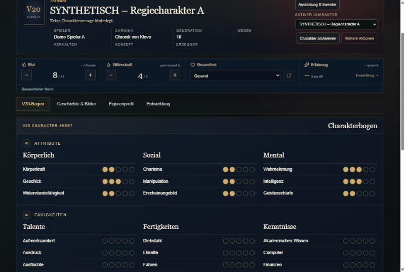 | 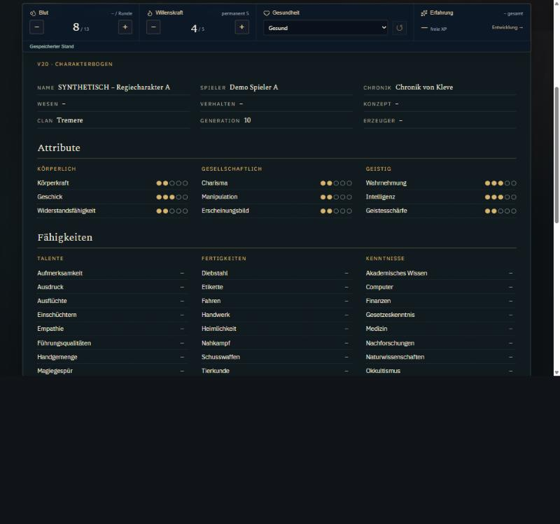 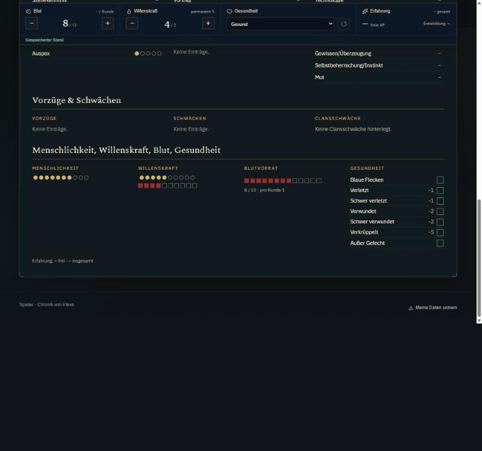 |
| Ingame-Menü 1280 px | 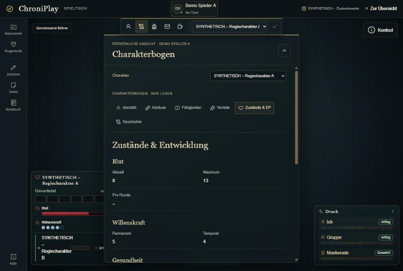 | 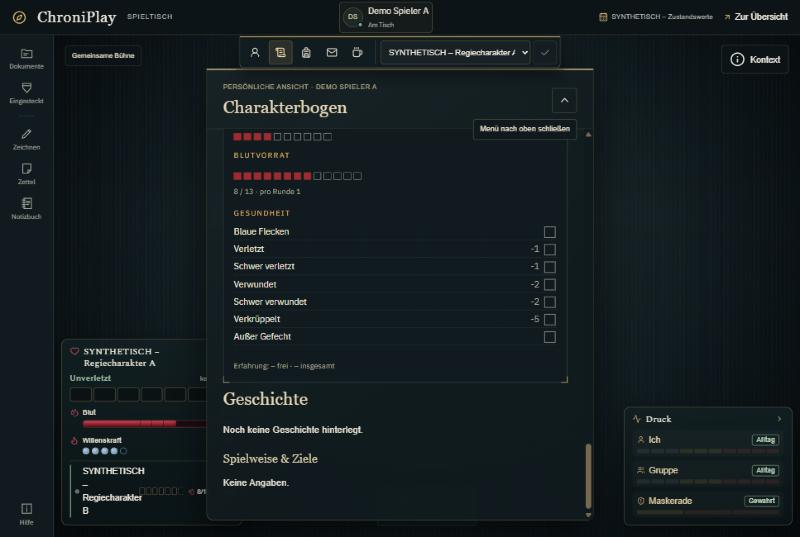 |
| Spielerzentrale 375 px | – | 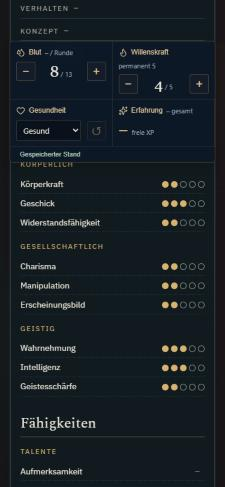 |

Den Vorher-Stand habe ich in einem temporären Worktree gebaut und danach samt seiner Testdatenbank gelöscht.

## Prüfungen (beobachtet)

| Prüfung | Ergebnis |
|---|---|
| Routenliste vor und nach dem Umbau | gleich |
| `pnpm run typecheck` | ohne Fehler |
| `pnpm test` | **403/403** (+7) |
| `node --experimental-strip-types --test tests/*.test.mjs` | **517/523**, dieselben 6 Altfälle |
| ESLint auf allen neuen und geänderten Dateien | ohne Befund |
| `pnpm run build` | erfolgreich |
| `pnpm run test:integration:run` | Exit 0 |
| `tests/character-sheet-integration.mjs` | 6/6 |
| Browser 1280 und 375 px | Spielerzentrale breit bzw. einspaltig, kein waagerechter Scroll (`scrollWidth` 375). Ingame schmal, Titel nach Korrektur im richtigen Stil |
| Kontrast | Bogentext auf `--cp-surface-1` 14,0:1, Nebentext 7,4:1, Gold 8,8:1 |

Beim Durchsehen behoben:
- Die Stile der Spielerleiste überschrieben im Ingame-Menü die Gruppentitel. Die Bogen-Stile sind jetzt spezifischer.
- Die Spezialisierungsvermerke der alten Ansicht fehlten zunächst im Modell, sind jetzt wieder vollständig.

## Prüfgrenzen

- **Testdaten:** Die synthetische Figur hat keine Fähigkeiten und keine Spezialisierungen. Die Fälle „über 5“, „Spezialisierung“, „eigene Fähigkeit“ sind per Unit-Test belegt, im Browser nur mit „fehlend“ und normalen Werten gesehen.
- **SL-Ansicht:** im Browser nicht geöffnet. Sie nutzt dieselbe Komponente `CharacterDetail` (Rechte per Integrationstest).
- **Kein echtes Mobilgerät**, kein Screenreader-Durchgang. Punkte und Kästchen haben Textalternativen (`role="img"`, `aria-label` mit Wert bzw. „nicht erfasst“).
- **Darüber liegende Bereiche:** Der feste Live-Block (Blut, Willenskraft, Gesundheit) über dem Bogen in der Spielerzentrale ist unverändert, ebenso die Reiter der Probenauswahl im Ingame-Menü.

## Offen

- **Bogen Seite 2, nicht im Datenmodell:** Haltung, Rituale, Kampfblock, Beschreibungsfelder. Das wäre ein eigener Auftrag mit Schemaänderung.
- **4c Navigation:** Die Zieltabelle legst du vor dem Umbau fest.

## Ausdrücklich nicht getan

Kein Push, kein Deployment, keine Migration, keine Datenänderung. Keine geänderten Routen, Rechte oder Projektionen. Das V20-Blatt ist nicht im Repo.

## Nachbesserung nach Kritik des Besitzers (09.11.2026)

**Kritik:**
- Der Kopf des Bogens stand doppelt da.
- Die Leiste mit Blut, Willenskraft und Gesundheit wanderte beim Scrollen mit und ist eigentlich sinnlos, weil diese Werte am Spieltisch gesteuert werden.
- Am Tisch soll die Aufteilung in Reiter bleiben.
- Die Optik war nicht schön genug, gewünscht ist mehr wie das V20-Blatt.
- Statt der drei Knöpfe im Kopf soll dort das Clan-Banner hängen.
- „Figurenprofil“ soll „Charakterprofil“ heißen.

**Umgesetzt:**
- **Live-Leiste entfernt:** Die Leiste mit Blut, Willenskraft, Gesundheit und Erfahrung ist aus der Charakteransicht (`CharacterDetail`) entfernt. Die Werte stehen lesend im Bogen, Erfahrung unter „Entwicklung“. Gesteuert werden sie am Spieltisch. Die Komponente `character-live-vitals.tsx` bleibt im Repo, wird hier aber nicht mehr eingebunden.
- **Kopf ohne Knöpfe:** Die Knöpfe sind aus dem Charakterkopf in eine eigene Aktionsleiste darunter gewandert: Ausrüstung & Inventar, Charakter archivieren, Weitere Aktionen, Charakter wechseln. Im Kopf hängt jetzt das **Clan-Banner** (vorhandene Grafik der Spielerzentrale).
- **Umbenennung:** Der Reiter heißt jetzt **„Charakterprofil“**.
- **Kein doppelter Kopf mehr:** In der Spielerzentrale lässt der Bogen die Kopfdaten weg, die stehen schon im Charakterkopf.
- **Ingame-Menü wieder mit Reitern:** Identität, Attribute, Fähigkeiten, Vorteile, Zustände & EP, Geschichte. Jeder Reiter zeigt seinen Abschnitt im neuen Bogenstil, die Probenauswahl ist unverändert.
- **Optik nach dem V20-Blatt:**
  - Zierrahmen mit Doppellinie und selbst gezeichneten Eckornamenten;
  - Kopfzeile mit dem Namen der Figur;
  - Abschnittstitel mittig mit Schmuckleisten links und rechts;
  - Gruppentitel in gesperrten Versalien;
  - Punkte wie gedruckte Kreise.

  Alles als eigene SVG-Zeichnung im CSS, keine Verlagsgrafik, kein Farbverlauf.

**Bilder:** 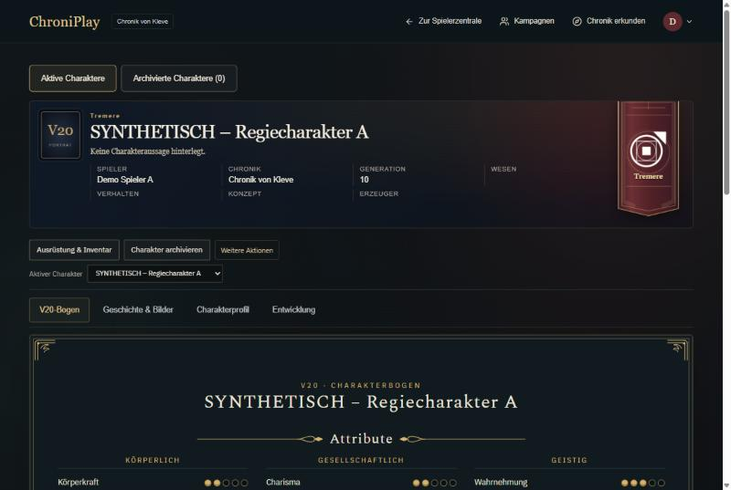 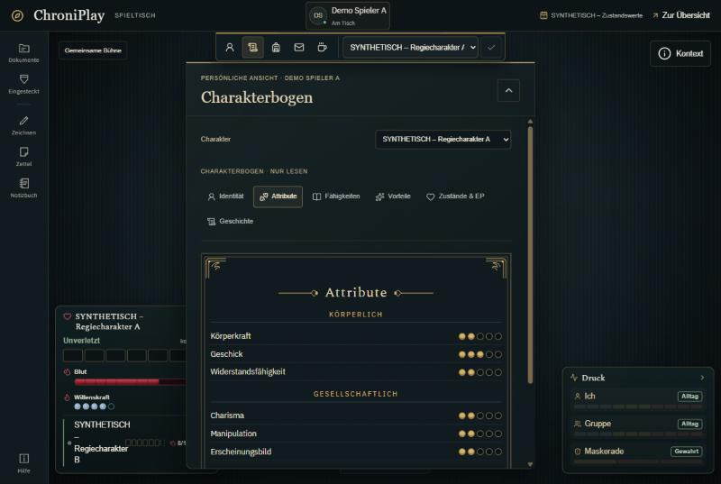

**Prüfungen:**

| Prüfung | Ergebnis |
|---|---|
| typecheck | ohne Fehler |
| ESLint auf den geänderten Dateien | ohne Befund |
| `pnpm test` | 403/403 |
| alle Testdateien | 517/523, dieselben 6 Altfälle |
| Build | erfolgreich |
| Browser 1280 px | Spielerzentrale und Ingame-Reiter geprüft |
| `test:integration:run` und Rechtetest | **nicht erneut ausgeführt.** Seit dem letzten grünen Lauf auf `854c481` ist nur Oberfläche geändert, keine Route und keine Projektion |
| Browser 375 px | nach der Nachbesserung **nicht** geprüft. Das Clan-Banner ist unter 700 px ausgeblendet |

**Offen, besprochen mit dem Besitzer:** Neuordnung des ganzen Charakterbereichs als eigener Schritt mit Zieltabelle:
- Charakterprofil mit den Feldern von Seite 2 (Vergangenheit, Antrieb, Haltung, Aussehen …);
- Notizen und Verbindungen aus „Geschichte & Bilder“ in Notizbuch bzw. Archiv;
- „Kontext für die nächste Nacht“ an einen anderen Ort;
- Porträt und Referenzen überarbeiten;
- „Aktive / Archivierte Charaktere“ neu gestalten;
- Charakterprofil optisch angleichen;
- die Bearbeitungsmaske entschlacken.

## Zweite Nachbesserung (09.11.2026)

**Wunsch des Besitzers:**
- Die Menüführung soll nach oben und schön gestaltet sein.
- „Aktive / Archivierte Charaktere“ soll dort aufgehen.
- Der Kopf mit dem Clan-Banner soll als eigener Block im Bogenstil über dem Bogen stehen.
- Die Bogen-Überschrift „V20 · Charakterbogen / Name“ soll wegfallen, weil der Name schon im Kopf steht.

**Umgesetzt:**
- **Menüleiste ganz oben** über dem Charakterkopf, auf der Rahmenebene:
  - Umschalter „Aktive / Archiviert (n)“, ersetzt die beiden großen Knöpfe darüber;
  - Ausrüstung & Inventar, Bogen bearbeiten (sofern berechtigt), Charakter archivieren, Weitere Aktionen, Charakterwahl;
  - sichtbarer Fokusring.

  Alle Ziele bleiben erreichbar. Im leeren Zustand (kein Charakter) steht der bisherige Umschalter weiter da.
- **Charakterkopf als Block im Bogenstil:** Doppelrahmen, Eckornamente, Spectral-Titel, Feldnamen in Gold-Versalien, Clan-Banner hängt vom oberen Rand.
- **Bogen-Überschrift** in der Spielerzentrale entfernt.

**Bild:** 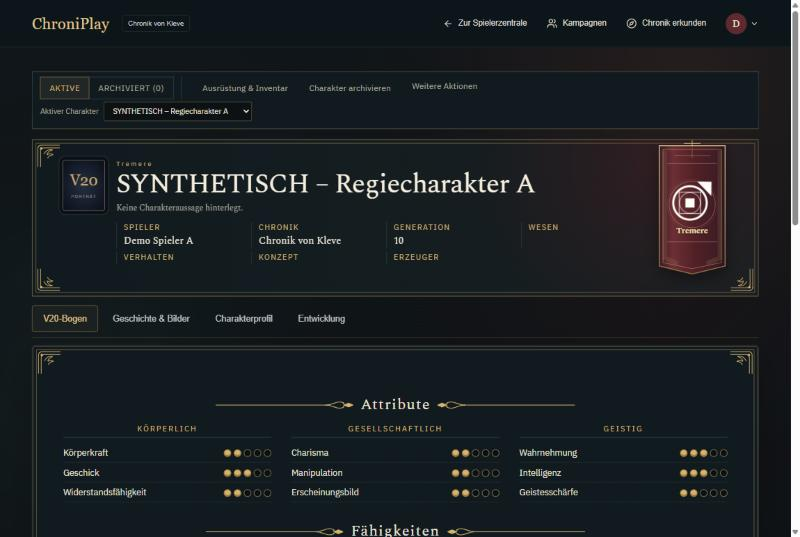

**Prüfungen:**
- typecheck, ESLint und Build ohne Fehler, `pnpm test` 403/403, Browser bei 1280 px.
- **Nicht geprüft:** 375 px, die Integrationsprüfung (nur Oberfläche geändert) und der leere Zustand im Browser.

## Dritte Nachbesserung (09.11.2026)

**Umgesetzt:**
- „Ausrüstung & Inventar“ steht jetzt bei den Reitern (rechts neben V20-Bogen, Geschichte & Bilder, Charakterprofil, Entwicklung), weil es zur Spielfigur gehört.
- Die Menüleiste oben ist auf breiten Bildschirmen einzeilig, ohne Umbruch in den Knöpfen.

**Bild:** 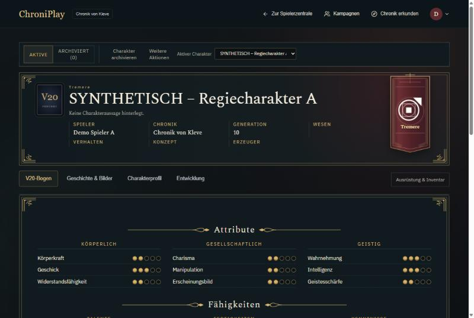. Die Aufnahme zeigt den Stand vor der Regel gegen den Umbruch.

**Prüfung:**
- Build und Browser bei 1280 px. Die zuletzt ergänzte Regel gegen Umbrüche in den Knöpfen ist **per Vorschau im Browser** geprüft (gleiche Regel ins Seiten-CSS gesetzt), nicht nach einem neuen Build.
- `pnpm test` 403/403.

**Zieltabelle zur Neuordnung:** [docs/design/CHARAKTERBEREICH-ZIELTABELLE.md](../design/CHARAKTERBEREICH-ZIELTABELLE.md).

## Charakterprofil ausgebaut (09.11.2026, Freigabe des Besitzers „Ja, ausbauen“)

Grundlage: [Zieltabelle](../design/CHARAKTERBEREICH-ZIELTABELLE.md), Entscheidung 1.

**Daten** (keine Migration, keine neue Tabelle): Neues Feld `profile` im Charakter-Body:
- `description` (Alter, Sieht aus wie, Todestag, Geschlecht, Ethnische Herkunft, Nationalität, Haarfarbe, Augenfarbe, Größe, Gewicht, Aussehen);
- `allies` (Verbündete & Kontakte);
- `visibility` je Block (Beschreibung, Geschichte, Antrieb und Auftreten, Verbündete & Kontakte): `private` (Spieler und SL) oder `group`.

Geschichte und Spielhilfe bleiben, wo sie gespeichert waren (`text`, `playGuide`). Regeln stehen in `domain/character-profile.ts`.

**Rechte:**
- **Schreiben:** `PATCH /api/character-companion {action:'profile'}`, nur Besitzer oder zuständige SL (`canEdit`), mit Versionsprüfung (409) und strengem Schema.
- **Eigene Ansicht und SL-Projektion:** das ganze Profil (`roleplay.profile`).
- **Andere Spieler am Tisch** (`/api/live-participants?view=profile`): nur Blöcke mit `group`, nur gefüllte Felder.
- **Erweiterung der Tischliste:** Ein Charakter erscheint jetzt auch dann in der Tischansicht anderer, wenn er nur Profilblöcke freigibt (bisher nur mit veröffentlichtem „Auftritt“).

**Oberfläche:**
- Reiter **„Charakterprofil“** für alle, auch in der SL-Ansicht, dort lesend bzw. nach Rechten. Der Reiter „Geschichte & Bilder“ entfällt.
- Im Profil, in dieser Reihenfolge:
  - Auftritt (bestehender Editor);
  - **Seite 2 im Bogenstil:** Beschreibung, Verbündete & Kontakte, Freigabe für Geschichte und Antrieb;
  - darunter die bisherigen Texte: Vergangenheit & Antrieb, Stimme/Haltung/Reflexe, Porträt & Referenzen, Bekannte Verbindungen.
- **Entfernt:** „Privat und geteilt“ (die Seiten sind im Notizbuch) und „Kontext für die nächste Nacht“ (steht in der Spielerzentrale). Entscheidung 3 der Zieltabelle als Standard übernommen.
- **Am Tisch** zeigt die Spielerleiste unter „Profil“ die freigegebenen Blöcke.

**Tests:**
- `tests/character-profile.test.mjs`, 3 Tests in `pnpm test`: Vorgaben privat, nur freigegebene Blöcke, Schema-Grenzen.
- `tests/character-profile-integration.mjs`, **12/12** gegen `--ge-01`: Besitzer speichert und liest, veraltete Version 409, unbekannte Felder 400, Spieler B kann nicht schreiben, nicht angemeldet 401, SL liest alles, Spieler B sieht am Tisch nur den freigegebenen Block, Aufräumen.

**Prüfungen:**

| Prüfung | Ergebnis |
|---|---|
| typecheck, ESLint, Build | ohne Fehler |
| `pnpm test` | 406/406 |
| alle Testdateien | 520/526, dieselben 6 Altfälle |
| `pnpm run test:integration:run` | Exit 0 |
| Browser | Charakterprofil bei 1280 px angesehen |

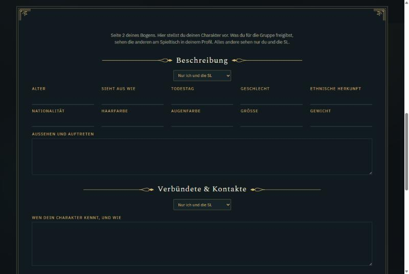

**Offen:**
- Ort der „Bekannten Verbindungen“ (Entscheidung 2); sie stehen vorerst lesend im Profil.
- Die alten Textblöcke unter dem Profil (Vergangenheit, Stimme, Porträt, Verbindungen) und der Auftritt-Editor („Figuren-Galerie“) haben noch ihre alte Optik bzw. Benennung.
- 375 px ist nicht geprüft.

## Nachtrag 09.11.: Charakterprofil als ein System

- Ein Rahmen, ein Speichern-Knopf: Auftritt (Kurzzeile, Vorstellung, Galerie, Sichtbarkeit), Beschreibung, Hintergrundgeschichte, „So spiele ich ihn“, Verbündete & Kontakte, Porträt & Referenzen, Bekannte Verbindungen, Vorschau „So sehen dich die anderen“.
- Server: `action:'profile'` speichert Profil, Auftritt, Geschichte und Spielweise in einem versionsgeschützten Schreibvorgang (Galerie nur mit eigenen Dateien).
- Entfernt als Doppelung: der alte Companion-Abschnitt (Geschichte/Spielweise mit eigenen Bearbeiten-Knöpfen), der separate Auftritt-Editor (`character-presentation-editor.tsx` gelöscht), der Block „Geschichte und Antrieb“ (nur Freigabe).
- Schutz: Ungespeicherte Profiländerungen blockieren das automatische Nachladen und fragen vor Reiterwechsel, Charakterwechsel und Bild-Upload nach.
- Nachweise: Typecheck sauber, ESLint ohne neue Warnungen, `pnpm test` 406/406, `tests/character-profile-integration.mjs` 17/17 (lokal `--ge-01`), Build grün, Sichtprüfung breit und 375 px ohne Überlauf. Lokale Testdaten `.local-test/ge-01` danach gelöscht.

## Nachtrag 09.11.: Eine Bildverwaltung

- Entscheidung des Besitzers: Auftritt-Galerie und „Porträt & Referenzen“ werden eins.
- Im Profil gibt es nur noch „Porträt & Referenzen“: bis zu 8 Bilder, je Bild Art (Porträt, Referenz, Stimmung, Szene), Bildunterschrift und Sichtbarkeit („Nur ich und die SL“ / „Für die Gruppe sichtbar“), höchstens ein Porträt. Gespeichert mit „Profil speichern“ in `body.characterMedia`; das Porträt wird zum Charakterbild.
- Die Galerie im Auftritt ist entfernt. Vorhandene Galeriebilder erscheinen beim Öffnen in der Bilderliste (freigegeben, wenn der Auftritt veröffentlicht war) und werden beim nächsten Speichern übernommen; die alte Galerie wird dabei geleert. Bis dahin zeigt der Tisch sie weiter, eine Migration ist nicht nötig.
- Tisch: Kopfbild = freigegebenes Porträt, Bildstreifen = übrige freigegebene Bilder. Nicht freigegebene Bilder liefert der Tisch nicht aus (404).
- Neue Bilder müssen eigene Uploads sein; bereits verknüpfte bleiben gültig, auch wenn die SL bearbeitet.
- Nachweise: Typecheck sauber, `pnpm test` 406/406, Build grün, `tests/character-profile-integration.mjs` 24/24 in zwei Durchläufen hintereinander (Aufräumen geprüft, synthetische Bilder gelöscht), Sichtprüfung im Browser. `.local-test/ge-01` danach gelöscht.

## Nachtrag 09.11.: Editor, Tisch-Galerie, Verbindungen

- Texteditor (gilt überall, wo der normale Editor genutzt wird): Zeile „Link zur Auswahl“ entfernt (bleibt nur in den SL-Editoren mit erweiterten Werkzeugen). Neue Leiste: Rückgängig/Wiederholen, Absatzformat (Normaler Text, Große Überschrift, Kleine Überschrift, Untertitel, Zitat), Fett/Kursiv/Unterstrichen/Durchgestrichen, Ausrichtung links/zentriert/rechts, Aufzählung, nummerierte Liste, Trennlinie, vier Kampagnenfarben als Punkte plus Farbrad für jede freie Farbe, „Formatierung entfernen“.
- Datenmodell: Farbe jetzt jede `#rrggbb` (sonst abgelehnt), neue Markierung `strike`, neue Klassen `cp-subtitle`, `cp-align-center`, `cp-align-right`. Bestehende Texte bleiben gültig. Tests: `tests/rich-text-editor-tools.test.mjs` (in `pnpm test`).
- Spieltisch: neuer Eintrag „Galerie“ im Teilnehmermenü (für alle). Zeigt Porträt und alle freigegebenen Bilder mit Vorschaureihe, Blättern und Vollbild. Private Bilder erscheinen nicht.
- Tischprofil: Überschriften heißen jetzt „Hintergrundgeschichte“ und „So spiele ich ihn“ wie im Bogen.
- Bekannte Verbindungen (Vorgabe des Besitzers): NSC-Verbindungen und Beziehungen zu anderen Spielercharakteren vergibt die SL. Der Spieler stellt eine Anfrage, die SL prüft und verknüpft. Die Anfrage-Funktion ist noch nicht gebaut; im Profil steht ein Hinweis.
- Nachweise: Typecheck sauber, `pnpm test` 408/408, Build grün, Profil-Integration 24/24, Browser: Überschrift, Untertitel, Zentrieren, Kampagnenfarbe und freie Farbe gesetzt, gespeichert und vom Server korrekt zurückgelesen; Tisch-Galerie als Spieler A geöffnet (2 freigegebene Bilder, privates fehlt). `.local-test/ge-01` gelöscht.
- Bekannter Altfehler unverändert: `tests/location-area-rich-text.test.mjs` scheitert an ERR_MODULE_NOT_FOUND (Ortsdossier).
