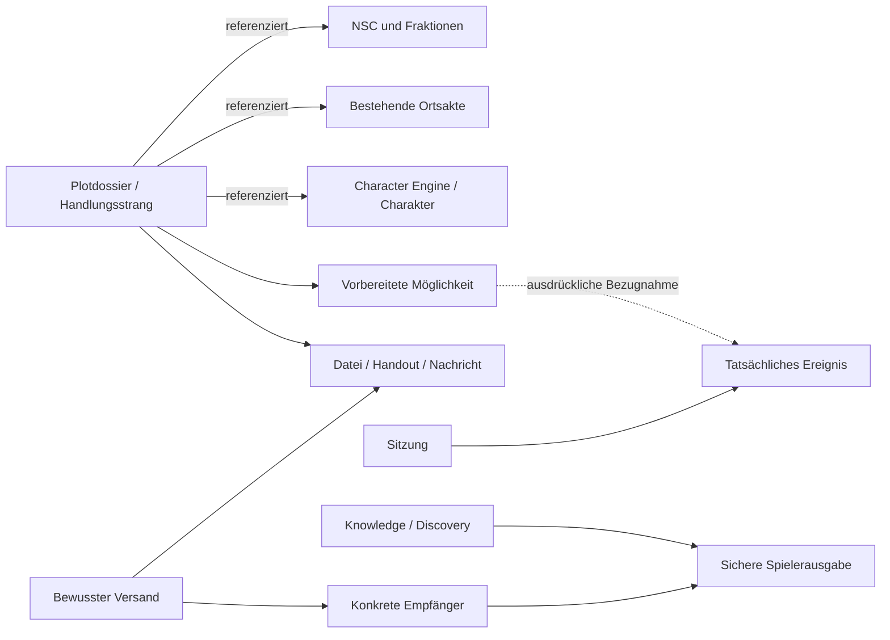

# Phasen B / C – Der digitale SL-Arbeitsplatz

**Status: VORSCHLAG ZUR ABNAHME.** Beschriebene Produktfunktionen sind noch keine Implementierungs- oder Veröffentlichungsbehauptung. Die beigefügte lokale Oberfläche ist ein synthetischer Interaktionsentwurf.

## 1. Die Leitentscheidung

Ich empfehle eine andockbare Arbeitsfläche mit frei wählbaren, mehrfach öffnungsfähigen Werkzeugen. Sie bietet die gewünschte Freiheit, ohne den Spielabend zu einer Verwaltung vieler überlappender Fenster zu machen. Vergrößern, schließen, umordnen und anheften bleiben direkte Handlungen. Bei Platzmangel wird innerhalb eines Werkzeuges gelesen, statt die gesamte Story aus dem Blick zu verlieren.

**Eigener Verbesserungsvorschlag:** Anheften hält die Referenz auf eine Person oder Akte fest, nicht eine veraltete Kopie ihrer Werte. Helena bleibt geöffnet, während andere Akten Corvina folgen; Helenas neue Laufzeitwerte erscheinen trotzdem nach berechtigtem Datenabgleich. Eine ausdrückliche historische Revision ist dagegen gesondert als solche gekennzeichnet.

Die Story besitzt einen unabhängigen Kontext. Ein Charakterwechsel schaltet niemals die aktuelle Geschichte um. Die SL kann außerdem mehrere Plotdossiers öffnen. Eine zweite Charakterverwaltung entsteht nicht.

Vorbereitung, Live-Regie und Nachklang sind persönliche Anordnungen derselben Werkzeuge und Daten. Ein Wechsel veröffentlicht nichts und verändert keine Weltzustände. Ein klarer Einstieg führt zum SL-CMS; Plattformkonten, Ressourcen und technische Administration bleiben in einem anderen Bereich.

## 2. Der echte Arbeitsablauf

| Situation | Handlung | Ergebnis / Sicherung |
|---|---|---|
| Vorbereiten | Plotdossier mit Konflikt, Motiven, Möglichkeiten und Referenzen schreiben | Privater Entwurf; laufende zuverlässige Speicherung, sichtbarer Speicherstatus. Keine Spielersicht. |
| Sitzung eröffnen | Sitzung und persönliche Anordnung wählen; Story, relevante Akten und Medien öffnen | Gemeinsamer Sitzungskontext, individuelle Werkzeuge. Alte Session-Daten bleiben lesbar. |
| Spontan reagieren | NSC-Motiv, Ort oder Hinweis über Suche/Verknüpfung öffnen | Bestehende zentrale Akte. Keine vorgeschriebene Szenenreihenfolge. |
| Persönlichen Inhalt ausspielen | Medium öffnen, erlaubten Inhalt prüfen, Empfänger wählen, bewusst senden | Konkreter Versand mit unveränderter Empfängerliste und Reader-Fassung. Öffnen ist niemals Freigabe. |
| Etwas geschieht | Einen „Moment“ mit einem Satz notieren | SL-interner tatsächlicher Eintrag; keine automatische Kanonentscheidung oder Erledigung vorbereiteter Möglichkeiten. |
| Nachbereiten | Tatsächliche Ereignisse prüfen, ergänzen, freigegebene Zusammenfassung verfassen | Gemeinsames Protokoll, persönliche Informationen und offene Möglichkeiten bleiben unterscheidbar. |

**Eigener Verbesserungsvorschlag „Momentnotiz“:** Sitzung, Zeitpunkt und gerade relevante Referenzen werden vorbefüllt. Die SL schreibt nur das Geschehene. Einordnen und ausführlich verknüpfen kann nach der Sitzung folgen. Das Programm erklärt keine NSC-Motive oder Konsequenzen selbst zu Wahrheit.

**Eigener Verbesserungsvorschlag „Sendeschale“:** Medien sind nicht direkt mit einem großzügigen „Teilen“-Knopf gekoppelt. Vor dem Versand zeigt eine kleine Vorschau die tatsächliche Reader-Fassung, genau benannte Empfänger, Anhänge und den späteren Zugriff. Kein erneutes Eintippen und keine automatische Auswahl „alle“.

## 3. Informationsarchitektur und zentrale Quellen

- **Plotdossier:** neue ausdrücklich gekennzeichnete CHRONICLE-Unterart in `entities`, etwa `documentKind: plot_dossier`, mit kleinen strukturierten Abschnitten und typisierten Referenzen. Alte Chronik-Records werden nicht umgedeutet. Ein Handlungsstrang kann mehrere Dossiers/Möglichkeiten verknüpfen.
- **Vorbereitete Möglichkeit:** SCENE-Unterart `prepared_situation`, kein vorgeschriebener Nachfolger. Voraussetzungen sind SL-Hilfen, keine Sperre der Geschichte. Freie Kommentare zu Alternativen und möglichen Konsequenzen.
- **Tatsächliches Ereignis:** eigene validierte fachliche Eintragsart mit Sitzung, Zeitpunkt, beteiligten Referenzen, Wissens-/Sichtbarkeitsangaben und optionalem Bezug auf eine Möglichkeit. Die endgültige Speicherung als typisierte Entity oder additive Occurrence-Tabelle wird nach SQL-/API-Probe festgelegt. `world_events` bleibt technischer Audit, wird nicht automatisch in fiktionale Ereignisse umgewandelt.
- **Ortsakte:** vorhandenes PLACE/location_nodes-System beschreibt Umgebung, Räume und Atmosphäre. Plot verlinkt sie. Kein Storytext als neue alternative Ortswahrheit.
- **NSC/Fraktion:** vorhandene Entitäten plus später typisierte Dossierfelder für Ziele, Motive, Zustand und tatsächliches Wissen. Beziehungen sind zentrale Referenzen; Storybuch hält keine zweite NSC-Kopie. Änderungen und Quelle bleiben nachvollziehbar.
- **Charakter:** nur Referenz auf bestehende Projektion/Engine/Inventar. Humanwissen, Charakterwissen und SL-Wahrheit sind getrennte Perspektiven.
- **Datei/Medium:** bestehende Datei-ID/R2-Quelle mit mehrfachen autorisierten Verwendungsreferenzen. Keine mehrfachen Binärdateien allein wegen mehrerer Storys.

Alle Beziehungen werden serverseitig auf Kampagne, Existenz und Berechtigung geprüft. Ein Link auf ein unbekanntes Geheimnis verrät einem Spieler weder dessen Titel noch dessen Existenz. Historische Recovery-Entitäten bleiben gesperrt, soweit ihr bestehender Status dies verlangt.

## 4. Storybuch und Editor

Das Plotdossier öffnet standardmäßig eine kurze Regieansicht: Kernkonflikt, beteiligte Motive, offene Fragen, relevante Geheimnisse und Möglichkeiten. Längere Hintergrundtexte bleiben in anklickbaren Abschnitten. Eine optionale Beziehungsansicht hilft bei komplizierten Zusammenhängen; sie ist keine Pflicht zur Diagrammpflege.

Vorschlag für Abschnitte: Kern, Hintergründe, Beteiligte, Wissen & Geheimnisse, Hinweise, Möglichkeiten, Folgen und SL-Kommentare. Vorlagen dürfen Struktur geben, aber keine nicht existierende Lore einfügen. Ein leerer Abschnitt bleibt leer.

Der vorhandene Rich-Text-Parser und Reader sind die Ausgangsbasis. Vor einer Entscheidung für eine andere Editorbibliothek: Pilot mit langem Text, Undo/Redo, Tastatur, Einfügen aus Word, IME, Tabellen und eingebetteten privaten Bildern. Das gegenwärtige `execCommand`-Werkzeug ist dafür nicht schon abgenommen.

Eine rückwärtskompatible Dokumentversion 2 kann Tabellen, Dateireferenzen und interne Entity-Verweise ergänzen. Alte v1-Dokumente bleiben unverändert lesbar. Private Kommentare besitzen eigene SL-Felder; sie werden nicht in einen Spieler-HTML-Export hineingerendert. Keine beliebigen HTML-/Iframe-/Script-Inhalte. Externe Medienanbieter werden nicht ungeprüft eingebettet.

Speicherung: sichtbarer Zustand „Änderungen offen / speichert / gespeichert / Konflikt“. Kurze Verzögerung bündelt Schreibvorgänge. Jede Mutation enthält die erwartete Revision und eine Request-ID. Ein Konflikt bewahrt den lokalen Text, bietet Vergleich und verlangt eine bewusste Zusammenführung. Eine historische Fassung bleibt wiederherstellbar, ohne aktuelle Releases unbemerkt umzubiegen.

**Datenschutzentscheidung offen:** Eine Crash-Wiederherstellung vertraulicher Dokumente im Browser braucht ausdrücklich festgelegte Lebensdauer, Gerätebindung und Logout-Löschung. Im ersten Produktabschnitt zuverlässiges serverseitiges Draft-Save; nicht automatisch ganze geheime Akten in dauerhaftes Local Storage kopieren. Im Konzept wird Local Storage ausschließlich für synthetische Daten verwendet.

## 5. Arbeitsplatz, Speicherung und zwei Monitore

Ein Werkzeug besitzt `panelInstanceId`, `moduleId`, Kontextbindung (`follow` oder `pinned`), stabile Aktenreferenz und lokalen Ansichtsstatus. Ein Layout ist ein validierter Split-Baum mit Richtung, Größenverhältnis und Blättern. Mindestgrößen, Fokusmodus und Tastaturmenüs verhindern unbedienbare Anordnungen. Das vorhandene `react-resizable-panels` ist die erste Grundlage; eine weitere Docking-Abhängigkeit benötigt eine begründete Probe.

Persönliche Layouts werden je Benutzer, Kampagne, Modus und Fensterrolle versioniert gespeichert. Im Browser stehen zunächst nur Layoutinformationen und Referenz-IDs; Berechtigungen werden beim Laden jeder referenzierten Akte erneut geprüft. Globale `settings` ohne Benutzerschlüssel sind keine geeignete Ablage. Eine kleine additive Layout-Tabelle kann nötig sein, aber erhält vor Ausführung einen getrennten Migrationsplan.

Monitor 2 verwendet ein weiteres gleichursprüngliches Browserfenster mit eigenem Layout und derselben angemeldeten Person. Ein Session-Koordinator synchronisiert Fokus/Sitzung und Datenänderungs-Hinweise. [BroadcastChannel](https://developer.mozilla.org/en-US/docs/Web/API/Broadcast_Channel_API) arbeitet zwischen Fenstern desselben Origins und derselben Storage-Partition; er liefert keine geräteübergreifende Synchronisierung und keine Authentifizierung.

Der Kanal überträgt nur Referenzen/Invalidierungen, keine geheimen Dossiers, Tokens oder Rollenbehauptungen. Jedes Fenster lädt Inhalte erneut über den autorisierten Serverpfad. Logout/Sperre schließt Inhalte in allen Fenstern. Unterschiedliche Charakterakten bleiben jeweils angeheftet. Die SL verschiebt das zweite Fenster selbst auf ihren zweiten Monitor; die Anwendung erhält keine unnötigen Bildschirmberechtigungen.

Ein zentraler Cache/Koordinator bündelt bestehende Abfragen nach Kampagne und Revision. Sichtbare Werkzeuge abonnieren dieselbe Quelle. Kein unabhängiger 10-Sekunden-Poller pro Instanz. Fokuswechsel, sichtbares Fenster und bestätigte Mutation invalidieren gezielt. Netzwerkfehler zeigen einen erkennbar veralteten oder gesperrten Zustand; eine alte Spielervorschau darf nicht als aktuelle Freigabe stehen bleiben.

## 6. Rollen und sichere Reader

| Aktion | Owner / campaign_gm aktiv | campaign_editor aktiv | Player aktiv | platform_admin ohne Kampagnenrolle |
|---|---|---|---|---|
| SL-Regie / Geheimnisse | bestehende Kampagnenberechtigung | kein automatischer Vollzugriff | nein | nein |
| Redaktion | kampagnenbezogen, vorhandene Einschränkungen bleiben | nur ausdrücklich zugewiesene zulässige Gruppenentwürfe | eigene erlaubte Charakter-/Notizwege | nur administrativer Bereich |
| Genehmigen / Ausspielen | ausdrückliche passende Fachberechtigung | kein selbstständiger Publish | nein | nicht durch Plattformrolle |
| Charakter/Inventar | nur nach bestehender Owner-/Sharing-Policy | kein pauschaler Zugriff | eigener/freigegebener Charakter | kein automatischer Zugriff |
| Reader / Medien | berechtigte SL-Ansicht oder ausgewählte sichere Vorschau | nur konkret erlaubte Revision | konkrete aktive Freigabe/Delivery | kein automatischer Inhalt |

Pending, blocked, fremde Kampagne und anonyme Zugriffe bleiben geschlossen. Die bestehende Anmeldung wird nicht ersetzt. Multi-Kampagnenfähigkeit darf aus dem aktuellen festgelegten Kleve-Actor nicht behauptet werden.

Die Produktintegration benötigt zwei getrennte Ausgaben: eine berechtigte SL-Projektion und eine Reader-Projektion mit ausdrücklicher Feldliste. Suche, Medien, Hub und Vorschau benutzen dieselbe Reader-Policy. Eigene unbekannte Geodaten oder GM_SECRET/Recovery-Originale werden nicht durch normale Grants freigegeben. Nach Widerruf gibt es keinen generischen Legacy-Ersatz.

Suchfilter greifen vor Treffern, Snippets und Zählungen. Favoriten und zuletzt geöffnete Akten speichern nur Referenzen; sie geben keine neuen Rechte. Beginnen mit begrenzter Suche im bestehenden D1-Datenbestand, ohne zusätzlichen externen Suchdienst. Volltextindex erst nach belastbarer Kompatibilitäts-/Performanceprobe.

## 7. Medien und Nachrichten

Erste Integration: vorhandene persönliche Textnachrichten und Knowledge-Freigaben, aber mit klar getrennten Aktionen. „Gelesen“ darf kein „Charakter weiß es“ werden. Die SL kann eine entsprechende Entdeckung separat bewusst bestätigen; das System kann die passenden Referenzen anbieten, entscheidet sie nicht.

Spätere Anhänge verwenden eine überprüfte konkrete Datei-/Inhaltsrevision, konkrete Empfänger und idempotente Delivery-ID. Server prüft Autor, Kampagne, Rollen, aktive Empfänger, Zweck und jede referenzierte Datei. D1-Mutation und Fachereignis werden transaktional zusammengehalten; R2-Uploads benötigen einen kontrollierten Ablauf für zunächst unzugeordnete Dateien und nachvollziehbare Fehlerbehandlung.

Nachrichten mit Bild/PDF bauen auf vorhandenen privaten Auslieferungswegen auf. Audio/Video benötigen vorab MIME-/Größenlimits, unterstützte Browserformate, geschützte Range-Requests und Verbrauchsprüfung. Kein zusätzlicher kostenpflichtiger Medienanbieter. Kein automatisches Abspielen bei Spielern; ein eingehender Inhalt wird angekündigt und bewusst geöffnet.

Ein Widerruf verhindert zukünftigen Zugriff, kann aber keine bereits gelesene Information oder heruntergeladene Datei aus dem Gedächtnis entfernen. Die Bedienung nennt diese Grenze. Bereits erhaltene persönliche Briefe besitzen derzeit keine allgemeine Widerrufsfunktion; eine spätere Funktion darf nicht einfach vorgetäuscht werden.

## 8. Rätsel – ausdrücklich spätere Freigabe

Eine Rätseldefinition referenziert Story/Medien. Eine getrennte Sitzungsinstanz enthält Aktivierung, Teilnehmer, freigegebene Hinweise und tatsächlichen Fortschritt. SL kann Hinweis geben, lösen markieren, stoppen und überspringen. Ein unerwarteter Lösungsweg bleibt gültig; das Rätsel erzwingt keinen Plot.

Zuerst kontrollierte Zustände und serverseitige Zielgruppen, dann bei Bedarf ein geprüfter interaktiver Renderer. Phaser ist eine mögliche austauschbare Darstellung für geeignete Rätsel, keine neue Plattform- oder Auth-Grundlage. **Keine Rätsel-Engine in diesem Konzeptpaket gebaut.**

## 9. Gestaltung und Ergonomie

Navy `#0b131d`, Flächen `#101d29`, Messing `#d2b47b`, Elfenbein `#efe6d4`; Rot nur sparsam für Blut/Gefahr, Grün für bestätigte Zustände. Serifentypografie für Story/Identität, gut lesbare Sans für Bedienelemente. Keine großen stimmungsvollen Hintergründe hinter langen Texten; Ornamente bleiben klein.

Laptop: zwei veränderbare Spalten, links meist Story, rechts wechselnde Akten und Versand. Kompakte Kopfleiste, Werkzeuge mit eigenem Scrollen. Alle Funktionen per Tastaturmenü erreichbar; Ziehen ist Komfort, keine Voraussetzung. Ein fokussiertes Werkzeug kann die Fläche übernehmen, seine Umgebung bleibt danach erhalten.

Desktop: größerer Leseraum und zusätzliche Akten, optional separates Fenster für Personen/Medien. Dieselbe Typografie und Komponentenstruktur, keine zweite Adminoberfläche. Smartphone ist für Spieler wichtig, aber nicht das Hauptgerät dieses SL-Auftrags; eine schmale Fallbackansicht darf Inhalte nicht unzugänglich machen.

## 10. Umsetzung in abnehmbaren Etappen

Diese Reihenfolge ist ein **Plan**, noch kein Auftrag zur Ausführung aller Schritte:

1. **Arbeitsplatzkern:** vorhandene Werkzeuge einbetten, Kontextbindungen, mehrere Instanzen, Größen, persönliche Anordnungen, sichere Mehrfensterkoordination. Zunächst ein Bildschirm und bestehende Daten. Abnahme: Story bleibt bei Personenwechsel; zwei Charaktere gleichzeitig; Reload erhält Layout.
2. **Storybuch-Pilot:** ein synthetisches typisiertes Plotdossier, bestehende Referenzen, Draft-Save, Konflikt/Wiederherstellung. Orts-/Charakterkomponenten nicht verändern. Abnahme: lange Texte, konkurrierende Schreibvorgänge, keine Spielerlecks, historische Chronik bleibt gleich.
3. **Live-Kette:** Suche, gezielte Text-/Bildbereitstellung, Momentnotiz, Nachbereitung mit bestehenden APIs. Abnahme mit SL und zwei unabhängigen synthetischen Spielerlogins; ein Brief nur bei A, kein Geheimnis bei B. Keine bloße Gruppenpreview als Loginbeweis.
4. **NSC-Dossier und reichhaltige Medien:** erst nach Feld-/Zustands- und Kostenabnahme. Bilder/PDF zuerst, Audio/Video später. Rätsel separat.

Vor neuen Schemaänderungen: genauen SQL-/Drizzle-Entwurf, Rückwärtskompatibilität, Datenumfang, Backup, Rollback und isolierte Tests vorlegen. Keine Migrationnummer reservieren oder Migration produktiv ausführen. Vor Produktintegration: Scope mit Pano bestätigen. Vor Veröffentlichung: persönliche Funktionsabnahme und ausdrückliche Release-Freigabe.

## 11. Abnahmekriterien und Risiken

- SL, Spieler A/B, gesperrter Account, Editor, fremde Kampagne und Plattform-only getrennt testen.
- Gleichzeitige XP-/Notiz-/Storyänderungen, stale Revisions und D1-Batch-Rollback nachweisen; keine Rules-Engine duplizieren.
- Geheimnisfelder, Medien-ID/URLs, Suchsnippets, Relations und verborgene Eltern dürfen nicht in Spielerantworten gelangen.
- Die Nutzerprobe umfasst eine spontane Entscheidung außerhalb der vorbereiteten Möglichkeiten. Das System darf sie nicht blockieren.
- Zwei synchronisierte Fenster bedeuten noch keinen zweiten physischen Monitor getestet. Betrieb mit physischer Hardware wird separat abgenommen.
- Offene Produktentscheidungen: Editor-Pilot, tatsächliche Ereignispersistenz, Layout-Tabelle, vertrauliche Crash-Wiederherstellung, Medienlimits und feinere Teilnehmergruppen.
- Keine automatischen V20-Moral-/Raserei-/Sozialentscheidungen, kein Kanonimport, keine Regeländerung durch dieses System.

**Ergebnis:** Ein konsistentes Konzept mit klaren Wiederverwendungsgrenzen und einem klickbaren Entwurf. Die vollständige Produktintegration und deren Sicherheitsabnahme bleiben ausdrücklich offen.
